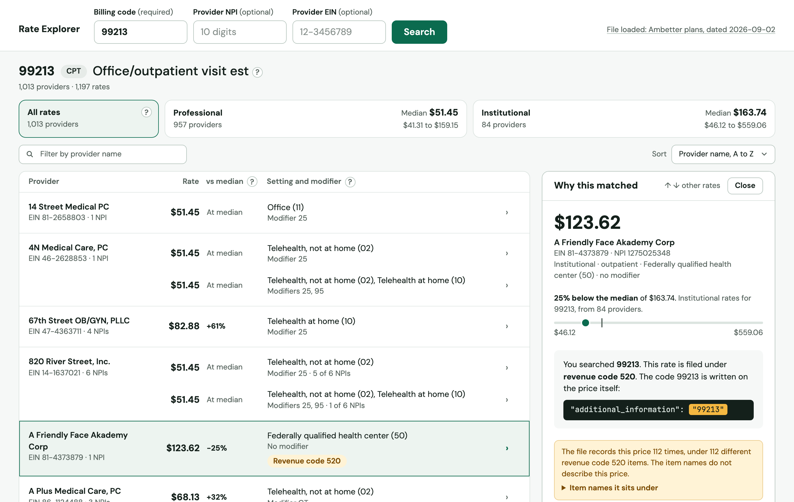
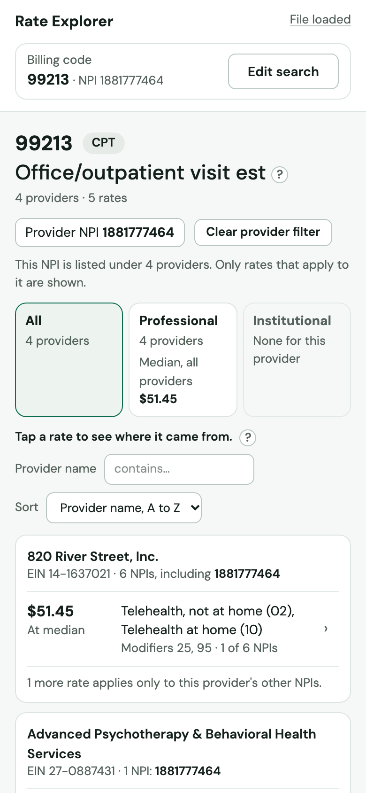
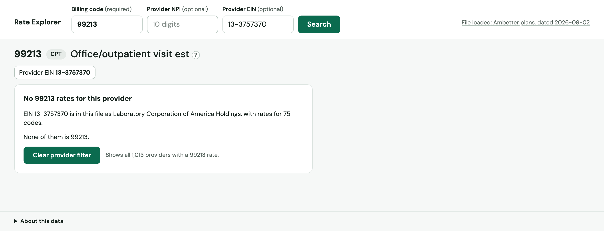
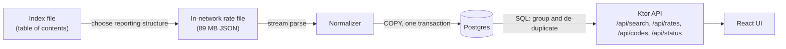

# Rate Explorer

Search the negotiated rates in a CMS Transparency in Coverage file by billing code, narrow them
by provider NPI or EIN, and trace any rate back to the exact record it came from.

**Try it:** https://serif.johnmorgannemelka.com is this code running on a small home server.
Search `99213`, add NPI `1881777464`, then select a rate.



## Run it

You need Docker.

```bash
docker compose up --build
```

Open http://localhost:3000. On first start the backend reads the index file, downloads the
89 MB rate file it points to and loads it into Postgres; the page shows progress and unlocks
search when it is done (about 10 seconds on my laptop after the images are built; longer on a
slow connection). Later starts skip the load.

Try `99213`, then add NPI `1881777464`, then click a rate. If a port is taken, copy
`.env.example` to `.env` and change it.

## What it does

- **Search** by billing code (required), with optional NPI and EIN. Input is checked beside
  the field, and the server applies the same rules. A box above the list narrows it to
  providers whose name contains what you type.
- **One result per provider**, with that provider's rates for the code listed inline:
  amount, how far it is from the median, place of service and modifiers in words.
- **Professional and institutional rates are summarized separately.** They are different
  things (a clinician's fee and a facility's), so a single pooled median would describe
  neither. The two summary tiles are also the filter.
- **Why this matched.** Selecting a rate shows which field the code was found in, where the
  record sits in the file (`in_network[485].negotiated_rates[17].negotiated_prices[0]`), the
  NPIs it applies to, the source files and the raw JSON. A small bar shows where the rate sits
  between the lowest and highest for its code and class. With a rate open, the up and down
  arrow keys step through the list.
- **Every state is handled:** file loading (real byte progress), index or file failed to
  fetch or parse (with the reason and a retry), a download that stalls, server unreachable,
  search failed, code not in the file (with the closest codes), provider has no rates for
  the code (clear the filter, keep the code), and invalid input. If a component throws
  anyway, the page shows a message and a reload button instead of going blank.
- **The address bar is the state**, so any search or open rate can be shared, and Back works.

| Narrowed to one NPI, on a phone | A provider with no rate for the code |
|---|---|
|  |  |

## Architecture and data flow



| Part | What it is | Where |
|---|---|---|
| Backend | Kotlin, Ktor, JDBI with hand-written SQL, Flyway | `backend/` |
| Database | Postgres 18 | `backend/src/main/resources/db/migration/` |
| Frontend | React, TypeScript, Vite, Tailwind, TanStack Query | `frontend/` |

1. **Index.** The backend fetches the index named in the assignment and picks the reporting
   structure whose plan names contain `Ambetter` (configurable). The rate file's URL always
   comes from the index.
2. **Download.** The file is streamed to a disk cache and reused if its size still matches.
3. **Parse.** Jackson's streaming parser walks the file one provider reference or one item at
   a time, so the document is never held in memory. Top-level keys can be in any order and
   unknown keys are skipped.
4. **Normalize and load.** Rows go into Postgres with `COPY` inside a single transaction.
5. **Search.** Each request runs in one repeatable-read snapshot, so a search that overlaps a
   reload sees either the previous complete file or the new one, never a mix. SQL joins
   prices to provider groups and collapses duplicates at query time (see below).

The server answers as soon as it starts; loading runs in the background and `/api/status`
reports it. A failed load never takes the server down, and a failed reload keeps serving the
data loaded earlier.

## What the data required

I profiled the file before designing anything. Four findings shaped the app.

**1. Most procedure codes are not where you would look.** 834 of the 1,519 items are revenue
codes (`RC`), and the real CPT or HCPCS code is written on each price's
`additional_information`. For those prices that value becomes the searchable code, and the
result is marked as filed under the revenue code. Index only `billing_code` and 56 providers
vanish from a 99213 search, including the hospitals with the highest prices.

**2. The file repeats itself heavily.** Each revenue-code price is copied under every item that
shares the revenue code (a median of 80 times across the file, 58 for 99213), and the item
names ("PUNCH BX SKIN SINGLE LESION" for an office visit) do not describe the price. A 99213 search touches 6,790 raw
price-by-provider-group rows that are really 1,197 distinct rates across 1,013 providers.
Results are de-duplicated by provider, amount, class, place of service, modifiers and
filed-under code; the detail panel says how many times the file repeats the rate.

**3. A provider is a tax ID, and an NPI can sit under several.** Results group by EIN. 1,168
EINs appear in more than one provider group and 124 are spelled more than one way; the name
shown is the most common spelling. NPI filtering works at provider-group level, so a provider
with two rates may show only the one that applies to the searched NPI, with a note about the
other.

**4. Some records are unusable.** 27 NPI entries are not valid: 26 are `0` and one has nine
digits. They are skipped and counted, not fatal, and the counts are shown under "About this
data" in the app. The same goes for a price whose rate is negative or absurdly large (this file
has none): `1e400` is valid JSON, and loading it would break the median for its code.

`RealFileCheckTest` asserts these figures against the live file (for the unusable NPIs, the
total of 27). I first computed them with a throwaway Python script, so the Kotlin and SQL are
checked against an independent implementation.

## Decisions and tradeoffs

- **Postgres, though in-memory was allowed.** Grouping, medians, paging and sorting are SQL
  the database does well, restarts do not re-ingest, and the "add a database" follow-up is
  already answered. The cost is that running it needs Docker.
- **De-duplicate at query time, not in a second table.** The base tables stay the only source
  of truth. The largest code joins about 7,000 rows, which takes milliseconds. A materialized
  rate table would be the next step for much larger files.
- **One rate file by default.** The index lists two (Ambetter, 89 MB; Essential Plan, 174 MB).
  The schema keys everything by source file and stores the plans, so loading the second is a
  configuration change (`PLAN_NAME_CONTAINS`), but there is no plan picker in the UI yet.
- **An item is parsed as one tree.** That bounds memory by the largest single item (about
  100 KB here), and lets one malformed item be skipped. A file with one enormous item would need
  streaming inside the item too.
- **`additional_information` is trusted only on revenue-code items and only when it looks like
  a code.** It is a free-text field in the schema; this rule fits this publisher.
- **Medians count each provider's price once**, per billing class. "vs median" always compares
  with every provider for the code, even when the search is narrowed to one.
- **The raw record is shown as the file wrote it:** same key order, and `539.40` stays
  `539.40` rather than becoming `539.4`.
- **Labels are conservative.** Place-of-service names follow the CMS code set. Modifier glosses
  are my own short wording, checked against a Medicare contractor's definitions; a modifier I
  could not check is shown as the bare code. Code descriptions are only what the file itself
  provides, and the file cuts them at 100 characters.
- **No authentication, and `/api/reload` is open.** Fine for a local tool, not for a deployed
  one: the hosted copy refuses reloads and limits request rates at its proxy.

## Tests

```bash
cd backend && ./gradlew test              # needs Docker (Postgres via Testcontainers)
cd backend && ./gradlew test -PrealFile   # also checks the real 89 MB file
cd frontend && npm ci && npm test         # unit and component tests
cd frontend && npm run e2e:up && npm run e2e && npm run e2e:down   # browser tests on the full stack
```

- **Backend:** the parser, normalizer and index selection as plain unit tests; ingestion and
  every query against a real Postgres, using a small fixture file that packs in the awkward
  cases (repeated revenue-code price, NPI of 0, inline provider groups, truncated JSON, header
  fields after the arrays). Failure paths are covered: unreachable index, missing rate file,
  truncated file, JSON that is not a rate file, failed reload, a download that ends early or goes quiet (against a local
  HTTP server), and a search that is open while the file is reloaded.
- **Frontend:** validation, formatting, each state, and the address-bar round trip.
- **End to end:** Playwright drives nginx, the API and Postgres in Docker, loading the fixture
  file. CI runs all three on every push.

## Development without Docker for the app

```bash
docker compose up -d db                   # Postgres on localhost:5544
cd backend && ./gradlew run               # API on :8080 (JDK 21 or newer)
cd frontend && npm ci && npm run dev      # UI on :5173, proxying /api to :8080
```

`INDEX_URL` may be a `file:` URL, which is how the tests point the app at fixtures.

## Running it on a server

`docker-compose.prod.yml` is an overlay for a shared host behind a proxy that terminates TLS.
Only the web container is published, the database has no route out, every container runs
without root privileges on a read-only filesystem with resource limits, and `DB_PASSWORD` has
no default.

```bash
DB_PASSWORD=... WEB_BIND=<address the proxy reaches> WEB_PORT=8490 \
  docker compose -f docker-compose.yml -f docker-compose.prod.yml up -d --build
```

The proxy should refuse `POST /api/reload`, which is open by design for local use.

## API

| Endpoint | Returns |
|---|---|
| `GET /api/status` | `loading` with phase and bytes, `ready` with file details, or `failed` with the reason |
| `GET /api/search?code=&npi=&ein=&name=&class=&sort=&page=&pageSize=` | Per-class summary, a page of providers with their rates, and a reason when empty |
| `GET /api/rates/{id}` | One rate traced to the file: match field, location, repeats, NPIs, raw record |
| `GET /api/codes?prefix=&limit=` | Codes in the file, for suggestions |
| `POST /api/reload` | Starts a fresh load |

## What I would do next

- A plan picker, and loading both rate files side by side.
- Match a provider by any spelling of its name. The name filter looks at the spelling shown,
  which is the most common one.
- Compare a provider's rate for a code across plans or over time, once more than one file is loaded.
- A materialized rate table and keyset paging for files ten times this size.
- Verified labels for every modifier in the file, from the HCPCS release rather than by hand.
- Authentication and rate limiting before this ran anywhere shared.

## How AI was used

I utilized both Fable and Astra for this project. Before writing any code, I had it explain the
rate file and mock up several UI directions. Afterwards, I chose the stack, picked the design direction and
approved the build plan; the agent then wrote most of the code and tests, and ran them.

Upon seeing the first result, I realized that the intent of the site wasn't immediately clear. The findings under "What the data required"
changed the design twice. First, results became one per provider once it was clear how much the file
repeats itself, and then I split the single median by billing class.

The result is more than I would have written by hand in the suggested three hours: a database,
a full set of empty and error states, and tests at three levels. The assignment says to expect
more polish when AI is used, so I spent the leverage on robustness rather than on extra features.
